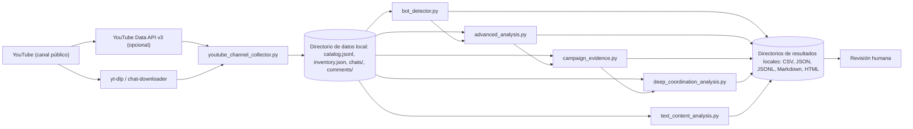

# asambots — análisis exploratorio de automatización y coordinación en YouTube

Conjunto de herramientas de línea de comandos, en Python puro, para **cosechar** chats de transmisiones
y comentarios públicos de un canal de YouTube y **analizar** si hay señales de comportamiento automatizado
o coordinado entre cuentas: repetición, cadencia, sincronía temporal, plantillas compartidas, narrativas
y recursos comunes.

> **Lectura responsable.** Ninguna herramienta declara que una cuenta sea un bot. Un puntaje alto significa
> **"vale la pena revisar la evidencia"**, no "automatización comprobada". Personas muy activas, consignas
> populares y reacciones simultáneas a un mismo momento de una transmisión pueden parecer coordinación.

## Funciones principales

| Herramienta | Qué hace | Salida principal |
|---|---|---|
| `youtube_channel_collector.py` | Inventario incremental de un canal: catálogo por ventana de fechas, chats de transmisiones finalizadas y comentarios con respuestas, con verificación por SHA-256. | `catalog.jsonl`, `inventory.json`, `chats/*.jsonl`, `comments/*.jsonl` |
| `bot_detector.py` | Priorización por cuenta (`signal_score`) y enlaces entre cuentas por texto igual o casi igual dentro de una ventana temporal. | `report.html`, `accounts.csv`, `coordination.csv` |
| `advanced_analysis.py` | Huellas de entropía y compresibilidad, prueba hipergeométrica de sincronía con corrección Benjamini–Hochberg, plantillas ponderadas por rareza, red multivista y sensibilidad al tamaño del bin. | `advanced_report.md`, `multiview_edges.csv` |
| `campaign_evidence.py` | Separa **orientación** (reglas de postura auditables) de **coordinación**: prueba estricta (apoyo directo) y amplia (apoyo + ataques), con correcciones humanas por CSV. | `campaign_report.md`, `stance_review.csv` |
| `deep_coordination_analysis.py` | Familias narrativas, variantes léxicas con MinHash/LSH, secuencias, recursos compartidos (URL, hashtags, emojis), red de respuestas, permutaciones circulares exactas y grupos de alta confianza. | `deep_report.md`, `coordination_candidates.csv` |
| `text_content_analysis.py` | Clasificación multietiqueta por mensaje: postura, temas, insultos, blancos de ataques y consignas; tasas por cuenta y por sesión; muestra para validación humana. | `content_report.md`, `message_classifications.csv` |

## Arquitectura resumida



Las flechas entre analizadores indican **reutilización de código** (por ejemplo, `advanced_analysis` importa el
análisis base de `bot_detector`), no una cadena obligatoria: cada analizador se ejecuta por separado sobre el
mismo directorio de datos. Detalle en [docs/ARCHITECTURE.md](docs/ARCHITECTURE.md).

## Inicio rápido

### Requisitos

- Python **3.9 o posterior** (se usa `str.removesuffix`). Los analizadores solo usan la biblioteca estándar.
- Solo para cosechar datos: [`yt-dlp`](https://github.com/yt-dlp/yt-dlp) (chats, y opcionalmente catálogo y
  comentarios) y, como respaldo opcional para chats, `chat-downloader`. Opcionalmente, una clave de la
  YouTube Data API v3.
- No hay `requirements.txt`; los analizadores no instalan dependencias.

```bash
python3 -m venv .venv
.venv/bin/python -m pip install -U yt-dlp          # solo si va a cosechar
.venv/bin/python -m pip install chat-downloader    # opcional, respaldo de chats
```

### 1. Cosechar un canal

El colector exige un permiso consciente para el raspado con `yt-dlp`:

```bash
export YOUTUBE_RASPADO=1
# Opción A: API oficial para catálogo y comentarios; yt-dlp solo para la repetición del chat
export YOUTUBE_API_KEY="..."        # no la escriba en archivos versionados
python3 youtube_channel_collector.py --channel https://www.youtube.com/@CANAL \
  --output-dir datos_canal --since 2026-05-01 --mode all --limit 10

# Opción B: sin clave, yt-dlp para todo
python3 youtube_channel_collector.py --channel https://www.youtube.com/@CANAL \
  --output-dir datos_canal --catalog-backend ytdlp --comments-backend ytdlp --limit 10
```

Sin `--channel`, `--output-dir` ni `--since`, se usan los valores predeterminados del código: el canal
institucional de la Presidencia de la República de Costa Rica, el directorio `presidencia_data/` y la fecha
inicial `2026-05-01`. La fecha final es, por defecto, la de ejecución (ambas inclusivas).

Para inspeccionar el catálogo sin descargar artefactos:

```bash
python3 youtube_channel_collector.py --mode catalog --dry-run
```

### 2. Analizar

```bash
python3 bot_detector.py analyze datos_canal --output results
python3 advanced_analysis.py datos_canal --output advanced_results
python3 campaign_evidence.py datos_canal --output campaign_analysis
python3 deep_coordination_analysis.py datos_canal --output deep_analysis
python3 text_content_analysis.py datos_canal --output text_analysis --validation-per-stratum 100
```

Cuando la entrada es la raíz del directorio de datos (con `catalog.jsonl`), `advanced_analysis`,
`campaign_evidence`, `deep_coordination_analysis` y `text_content_analysis` usan el catálogo como lista
permitida y descartan artefactos de videos fuera de la ventana (el resumen registra cuántos). Para analizar
solo chats, pase `datos_canal/chats`.

## Estructura del repositorio

```text
asambots/
├── youtube_channel_collector.py   # Cosecha incremental: catálogo, chats, comentarios, inventario con SHA-256
├── bot_detector.py                # Base: parser JSONL, normalización, signal_score, enlaces texto-tiempo, HTML
├── advanced_analysis.py           # Huellas, sincronía hipergeométrica + BH, plantillas, red multivista, sensibilidad
├── campaign_evidence.py           # Reglas de postura + redes estricta/amplia + correcciones humanas
├── deep_coordination_analysis.py  # Narrativas, MinHash/LSH, secuencias, recursos, respuestas, permutaciones
├── text_content_analysis.py       # Postura, temas, insultos, blancos, consignas, muestra de validación
├── tests/                         # unittest: 78 pruebas sin red ni credenciales
│   ├── test_bot_detector.py
│   ├── test_advanced_analysis.py
│   ├── test_campaign_evidence.py
│   ├── test_deep_coordination_analysis.py
│   ├── test_text_content_analysis.py
│   ├── test_youtube_channel_collector.py
│   └── test_logica_pura.py        # Reglas de puntuación, estadística, CLI local e inventario
├── docs/
│   ├── ARCHITECTURE.md            # Componentes, flujos, secuencias, despliegue
│   ├── SPEC.md                    # Requisitos, contratos de CLI y formatos, criterios de aceptación
│   └── TESTING.md                 # Estrategia, inventario de suites, brechas
├── .gitignore                     # Excluye datos y resultados generados
└── README.md
```

Los directorios de datos y de resultados se **generan localmente** y no se versionan (ver `.gitignore`):
contienen identificadores, nombres públicos y textos de cuentas de YouTube.

## Configuración

| Variable / opción | Uso | Dónde vive |
|---|---|---|
| `YOUTUBE_RASPADO=1` | Permiso explícito para usar `yt-dlp`. Sin él, el colector termina con código 2 si la corrida necesita raspado. | Entorno de la sesión |
| `YOUTUBE_API_KEY` | Clave de la YouTube Data API v3 para catálogo y comentarios (backend `api`, o `auto` si existe). | Entorno de la sesión; nunca en el repositorio |
| `YTDLP_BIN` | Ruta explícita a `yt-dlp` (si no, se busca en `PATH` y junto al intérprete). | Entorno |
| `--cookies` / `--cookies-from-browser` | Cookies para `yt-dlp` cuando YouTube limita las solicitudes. | Archivo local fuera del repositorio |

No hay archivos de configuración locales. Todos los parámetros de análisis son argumentos de CLI
(ver [docs/SPEC.md](docs/SPEC.md)).

## Comportamiento destacado del colector

- **Idempotencia.** `inventory.json` guarda por video el estado independiente de chat y comentarios, intentos,
  ruta, conteo, bytes y SHA-256. Antes de saltar un artefacto completo verifica que exista y que coincidan tamaño
  y hash; si no, lo marca `missing` o `changed` y lo vuelve a procesar. Adopta archivos preexistentes aún no
  inventariados.
- **Ausencias confirmadas.** `unavailable` y `not_applicable` no se vuelven a solicitar salvo con
  `--retry-unavailable`; los errores transitorios (`error`) sí se reintentan en otra corrida.
- **Fechas exactas.** En modo `yt-dlp` el catálogo activa `youtubetab:approximate_date` (las entradas planas
  suelen traer `timestamp: null`) y luego **hidrata** cada candidato para obtener su fecha exacta antes de aplicar
  la ventana, de modo que un video subido días antes del límite no entre por redondeo. `--approximate-catalog-dates`
  omite la hidratación (más rápido, menos preciso). `upload_date` tiene precedencia sobre `published_at`.
- **Protección del catálogo.** Si `yt-dlp` encuentra videos pero ninguno trae fecha, el programa termina con
  código 3 y conserva el catálogo anterior en vez de sobrescribirlo con uno vacío.
- **Rotación de clientes.** Chat, comentarios e hidratación rotan clientes de YouTube (`web,ios`, `android`, `tv`,
  `mweb`, `web_embedded`) para recuperarse de errores transitorios como *The page needs to be reloaded*.
- **Chats heredados.** `--legacy-chat-dir` importa repeticiones crudas cuyo nombre contiene `__VIDEOID__chat.jsonl`,
  las convierte al esquema canónico sin alterar la fuente y registra ambos hashes. Con
  `--legacy-only --no-refresh-catalog --mode chats` no hace solicitudes remotas.
- **Paralelismo.** `--mode comments --comment-workers N` descarga comentarios en paralelo; las escrituras de
  `inventory.json` se serializan. Use valores conservadores.
- **Precisión temporal.** Los comentarios obtenidos con `yt-dlp` tienen fecha con precisión diaria
  (`time_precision = "day"`); participan en señales de texto, repetición y plantillas, pero **nunca** en cadencia ni
  sincronía por segundos.

## Qué mide `bot_detector.py`

El `signal_score` (0–100) combina:

- repetición dentro de la cuenta (25 %);
- reutilización de los mismos textos en sesiones diferentes (15 %);
- intervalos muy cortos (≤ 15 s) y densidad por minuto activo (20 %);
- volumen relativo dentro del corpus (10 %);
- mensajes iguales o casi iguales de cuentas distintas dentro de la ventana temporal (30 %).

Con menos de 10 mensajes el puntaje se atenúa proporcionalmente y con menos de 5 la cuenta queda como
`evidencia_insuficiente`. En `accounts.csv`, las columnas `*_component` muestran cada señal en escala 0–100;
`review_reasons` enumera las señales dominantes y `dominant_text` permite comprobar si la repetición es real.
Las celdas que empiezan con `=`, `+`, `-` o `@` se neutralizan para que el contenido del chat no se ejecute como
fórmula al abrir un CSV.

La similitud "casi igual" usa Jaccard sobre palabras informativas (umbral predeterminado 0,84). Esta puntuación
**no** contiene listas de actores, partidos, consignas, sentimiento ni postura política. Los mensajes breves y
genéricos se excluyen de los enlaces exactos.

## Análisis avanzado, de campaña, profundo y de contenido

- **`advanced_analysis.py`**: el modelo nulo temporal trabaja por sesión y solo sobre bins con actividad, lo que
  reduce el efecto de recesos pero no elimina reacciones orgánicas simultáneas. Texto sincronizado y plantillas
  compartidas cuentan como **una sola** familia de evidencia. `multivista_fuerte` exige dos vistas, sincronía
  recurrente en al menos dos sesiones y puntaje combinado ≥ 45. La sensibilidad se calcula por defecto con bins de
  20, 30, 45 y 60 s (`--sensitivity-bins 30` para una corrida rápida).
- **`campaign_evidence.py`**: las etiquetas de postura salen de expresiones regulares auditables (términos
  genéricos de Gobierno y nombres de figuras públicas) y pueden confundir ironía, citas o negaciones. Revise
  `stance_review.csv` y corrija con `--labels etiquetas.csv` (columnas `normalized_text,label`). Etiquetas válidas:
  `direct_support`, `ambiguous_support`, `possible_criticism`, `opposition_or_institution_attack`, `other`. La
  afinidad política nunca se interpreta, por sí sola, como prueba de coordinación.
- **`deep_coordination_analysis.py`**: alta confianza exige sincronía significativa (q ≤ 0,05) bajo la distribución
  exacta de todos los desplazamientos circulares, *lift* ≥ 1,5 con solapamiento en ≥ 2 sesiones, otra vista
  independiente y recurrencia en ≥ 3 sesiones. Los bins que sostienen resultados significativos se materializan en
  `temporal_overlap_evidence.csv`. Si el descargador no entregó `parent_id`, la red de respuestas se reporta como
  **no disponible**, no como ausencia de interacción.
- **`text_content_analysis.py`**: separa tasas por cuenta y por sesión para no confundir volumen con concentración
  de lenguaje agresivo. Antes de publicar cifras, complete la revisión de `human_validation_sample.csv`. Una consigna
  compartida es una coincidencia textual, no prueba de automatización.

## Cómo leer los resultados

1. Empiece por el informe (`report.html` o los `*.md`), pero confirme cada hallazgo en los CSV y en el texto original.
2. Dé más peso a evidencia repetida en varias sesiones y con varios textos distintivos; una frase viral es evidencia débil.
3. Compare cuentas con actividad equivalente. El volumen por sí solo tiene peso limitado.
4. Documente hipótesis alternativas: audiencia organizada, citas, campaña legítima, moderación o un evento que
   provoque respuestas simultáneas.
5. Afirmar automatización requiere datos adicionales (metadatos públicos de los canales, observación más larga y
   validación manual ciega).

## Pruebas

```bash
.venv/bin/python -m unittest discover -s tests -v
```

Resultado actual: **78 pruebas, todas en verde**, sin red ni credenciales. Ver [docs/TESTING.md](docs/TESTING.md).

## Operación

Es una herramienta de investigación que se ejecuta **a mano** en una computadora local; no tiene servicio
desplegado ni tareas programadas. La cosecha es incremental: relance el colector (por lotes con `--limit`) hasta
completar el inventario.

## Documentación

- [docs/ARCHITECTURE.md](docs/ARCHITECTURE.md) — contexto, componentes, flujos de datos y diagramas de secuencia.
- [docs/SPEC.md](docs/SPEC.md) — requisitos, contratos de CLI, formatos JSONL y criterios de aceptación.
- [docs/TESTING.md](docs/TESTING.md) — estrategia de pruebas, inventario y brechas.

## Estado y limitaciones conocidas

- La coordinación se infiere solo por proximidad temporal, similitud textual, narrativas y recursos compartidos.
  No se consultan perfiles de YouTube ni información externa.
- No distingue una herramienta de publicación de una persona que copia y pega manualmente.
- Las reglas de postura, temas e insultos son específicas del español de Costa Rica y del contexto político del
  corpus para el que se escribieron; deben revisarse antes de reutilizarse en otro contexto.
- Los umbrales son transparentes y ajustables, pero no están validados contra ejemplos etiquetados; no deben usarse
  para decisiones de impacto sin esa validación.
- `bot_detector.py` no aplica el filtro por `catalog.jsonl` que sí aplican los demás analizadores.
- El colector depende de `yt-dlp`, cuyo comportamiento frente a YouTube cambia con frecuencia.
