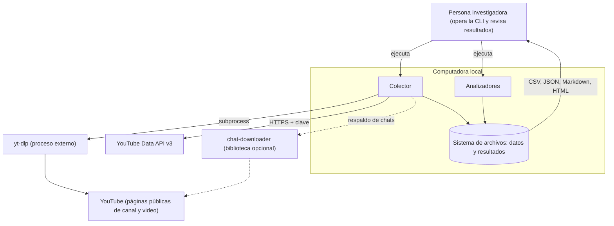
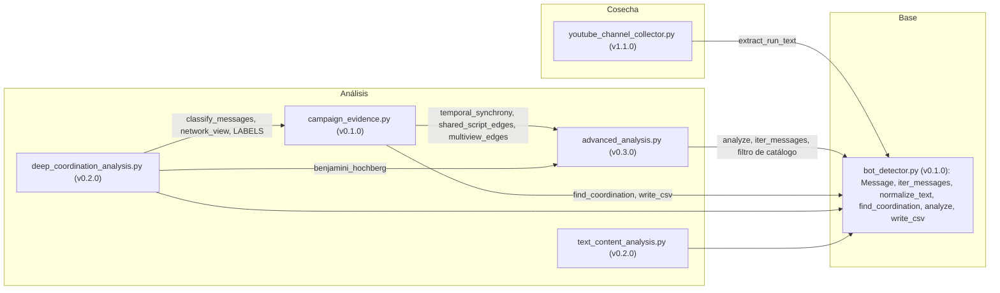
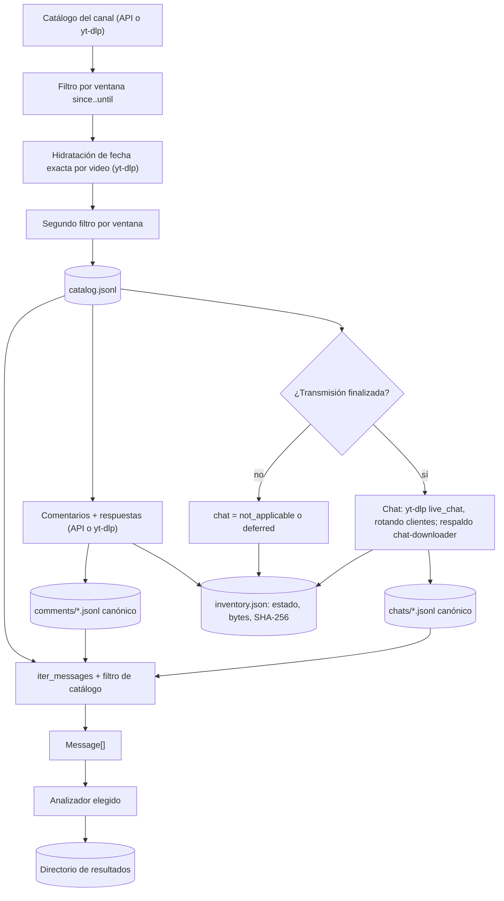
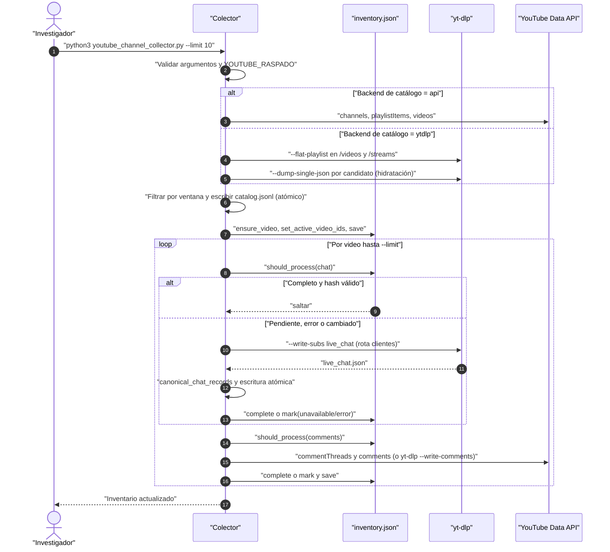
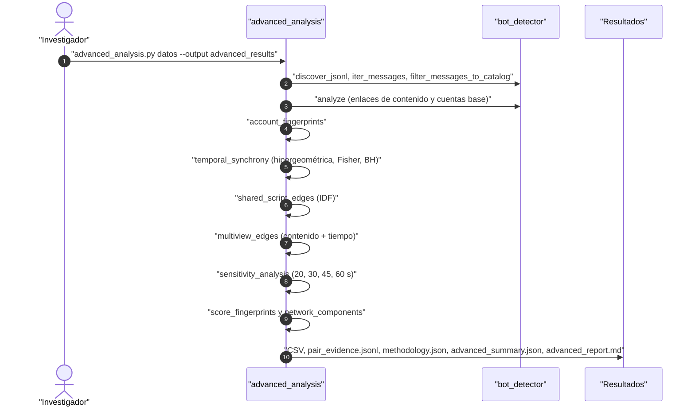
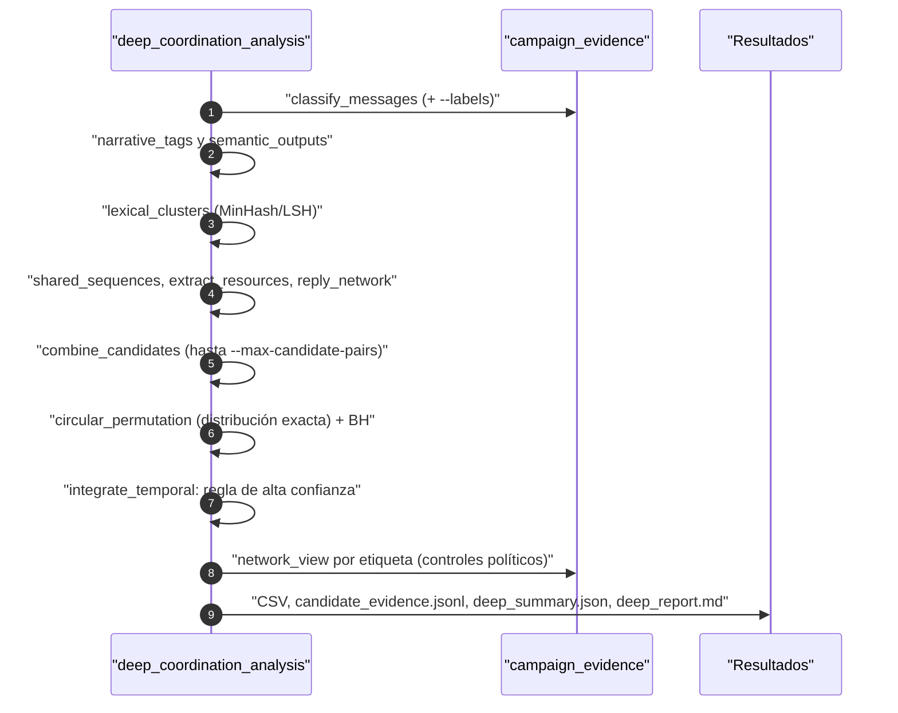

# Arquitectura

Este documento describe cómo está construido `asambots`: actores y sistemas externos, componentes, flujos de
datos, secuencias clave y dónde corre cada pieza. Todo lo descrito sale del código versionado.

## 1. Contexto

| Actor / sistema | Rol |
|---|---|
| Persona investigadora | Ejecuta el colector y los analizadores, revisa los informes y completa la validación humana (`human_validation_sample.csv`, `--labels`). |
| YouTube | Fuente de los datos públicos: catálogo del canal, repeticiones de chat y comentarios. |
| YouTube Data API v3 | Backend opcional (`api`) para catálogo (`channels`, `playlistItems`, `videos`) y comentarios (`commentThreads`, `comments`). |
| `yt-dlp` | Proceso externo invocado con `subprocess.run` para catálogo plano, hidratación de fechas, repetición del chat (`--sub-langs live_chat`) y comentarios. |
| `chat-downloader` | Respaldo opcional si `yt-dlp` no logra descargar un chat (se importa solo si está instalado). |

No hay base de datos, servidor web, nube ni tareas programadas. El intercambio entre componentes es por
archivos JSONL/CSV/JSON en disco.

## 2. Componentes

| Componente | Responsabilidad | Funciones clave |
|---|---|---|
| `youtube_channel_collector.py` | Descubrir el catálogo de un canal dentro de una ventana de fechas, descargar chats y comentarios a JSONL canónico y mantener `inventory.json`. | `discover_channel_api`, `discover_channel_ytdlp`, `hydrate_catalog_dates_ytdlp`, `download_chat`, `download_comments_api`, `download_comments_ytdlp`, `process_comments_parallel`, `Inventory`, `import_legacy_chat` |
| `bot_detector.py` | Capa base compartida: lectura de los tres formatos de entrada a `Message`, normalización de texto, enlaces texto-tiempo entre cuentas, `signal_score` por cuenta, clústeres, CSV seguro e informe HTML. | `iter_messages`, `filter_messages_to_catalog`, `normalize_text`, `find_coordination`, `analyze`, `build_clusters`, `write_csv`, `write_html` |
| `advanced_analysis.py` | Huellas por cuenta (entropía, compresión, periodicidad, forma de sesión), sincronía temporal por pares con prueba hipergeométrica + Fisher + Benjamini–Hochberg, plantillas compartidas ponderadas por IDF, red multivista, componentes y sensibilidad por bin. | `account_fingerprints`, `temporal_synchrony`, `shared_script_edges`, `multiview_edges`, `score_fingerprints`, `network_components`, `sensitivity_analysis`, `write_pair_evidence` |
| `campaign_evidence.py` | Reglas de postura frente al Gobierno, correcciones humanas, resumen por cuenta, plantillas de apoyo y redes multivista sobre subconjuntos estricto y amplio. | `classify_text`, `load_overrides`, `classify_messages`, `account_summary`, `network_view`, `coverage`, `concentration` |
| `deep_coordination_analysis.py` | Etiquetas narrativas, variantes léxicas (MinHash con 24 permutaciones, 6 bandas de 4, Jaccard ≥ 0,68), trigramas de narrativas, recursos compartidos, red de respuestas, permutación circular exacta, integración de vistas y grupos de alta confianza. | `narrative_tags`, `lexical_clusters`, `shared_sequences`, `extract_resources`, `reply_network`, `circular_permutation`, `integrate_temporal`, `components`, `political_controls`, `validation_sample` |
| `text_content_analysis.py` | Clasificación multietiqueta por mensaje (postura, temas, insultos, blancos atacados por proximidad), consignas, perfiles por cuenta y sesión, matriz tema × postura y muestra estratificada de validación. | `classify_stance`, `classify_content`, `slogan_key`, `is_slogan_candidate`, `catalog_metadata` |

### Modelo interno común

Todos los analizadores convierten la entrada a `bot_detector.Message` (dataclass inmutable):

| Campo | Significado |
|---|---|
| `session` | `video_id` para chat; `<video_id>__comments` para comentarios (separa ambas fuentes del mismo video). |
| `time_ms` | Chat: desfase dentro de la repetición en milisegundos. Comentarios: época Unix en ms de `published_at`. |
| `author_id`, `author_name` | Identificador del canal del autor y nombre mostrado. |
| `text`, `normalized` | Texto original y normalizado (NFKC, minúsculas, URL → `<url>`, sin puntuación). |
| `source` | `chat` o `comment`. |
| `time_precision` | `exact`, o `day` para comentarios obtenidos con `yt-dlp`. Solo `exact` participa en cadencia y sincronía. |

## 3. Flujos de datos

Formatos de entrada aceptados por `iter_messages` (cualquier `*.jsonl` encontrado recursivamente):

1. **Chat canónico** (`record_type = "chat_message"`), producido por el colector.
2. **Comentario canónico** (`record_type = "comment"`), producido por el colector.
3. **Repetición cruda de YouTube** (`replayChatItemAction`), tal como la exporta `yt-dlp`; la sesión se toma del
   nombre de la carpeta contenedora.

Las líneas de otros tipos (por ejemplo, `catalog.jsonl`) se ignoran sin error; una línea con JSON inválido
detiene el análisis con un mensaje que indica archivo y línea.

## 4. Secuencias clave

### 4.1 Corrida incremental del colector

### 4.2 Análisis multivista (`advanced_analysis.py`)

### 4.3 Análisis profundo de coordinación

## 5. Modelo de despliegue

| Pieza | Dónde corre | Cómo se inicia |
|---|---|---|
| Colector | Computadora local con Python ≥ 3.9 y `yt-dlp` | A mano, por lotes (`--limit`), relanzando hasta completar el inventario |
| Analizadores | Misma computadora; solo biblioteca estándar | A mano sobre el directorio de datos |
| Datos y resultados | Directorios locales generados (ignorados por git) | Creados por las herramientas |

No se encontró en el repositorio configuración de servicios, contenedores, CI ni tareas programadas.

## 6. Dependencias externas y cuotas

| Dependencia | Uso | Límite / riesgo |
|---|---|---|
| YouTube Data API v3 | Catálogo y comentarios con `YOUTUBE_API_KEY` | Cuota diaria por proyecto de Google Cloud; cada página de `playlistItems`, `videos`, `commentThreads` y `comments` consume cuota. Un error `commentsDisabled` se registra como `unavailable`. |
| `yt-dlp` | Catálogo, fechas, chat y comentarios | Limitación de tasa de YouTube; el código añade `--sleep-requests 1` en comentarios, `--sleep` entre videos (5 s) y `--client-sleep` al rotar clientes (3 s). Cookies opcionales. |
| `chat-downloader` | Respaldo de chat | Opcional; si no está instalado se omite. |

## 7. Decisiones de diseño visibles en el código

- **Sin dependencias en los analizadores.** Todo el análisis estadístico (hipergeométrica en espacio logarítmico,
  Fisher, BH, MinHash) está implementado con la biblioteca estándar para que sea reproducible y auditable.
- **Contenido político fuera del puntaje base.** `bot_detector` no usa listas de actores, postura ni sentimiento;
  la orientación se trata aparte (`campaign_evidence`, `text_content_analysis`) y nunca se interpreta como
  prueba de coordinación.
- **Evitar doble conteo.** Texto sincronizado y plantillas compartidas forman una sola familia de evidencia en
  `multiview_edges`.
- **Precisión temporal explícita.** `time_precision` impide que fechas diarias se usen como horas exactas.
- **Escrituras atómicas e idempotencia.** `atomic_json` y `atomic_jsonl` escriben a un temporal y reemplazan; el
  inventario valida tamaño y SHA-256 antes de saltar trabajo.
- **Consentimiento explícito para raspar.** `YOUTUBE_RASPADO=1` es obligatorio cuando la corrida usaría `yt-dlp`.
- **Seguridad de CSV.** `write_csv` antepone `'` a celdas que empiezan con `=`, `+`, `-` o `@`.
- **Auditabilidad.** Cada analizador materializa la evidencia de los pares (`pair_evidence.jsonl`,
  `temporal_overlap_evidence.csv`, `candidate_evidence.jsonl`) y una muestra para validación humana.
