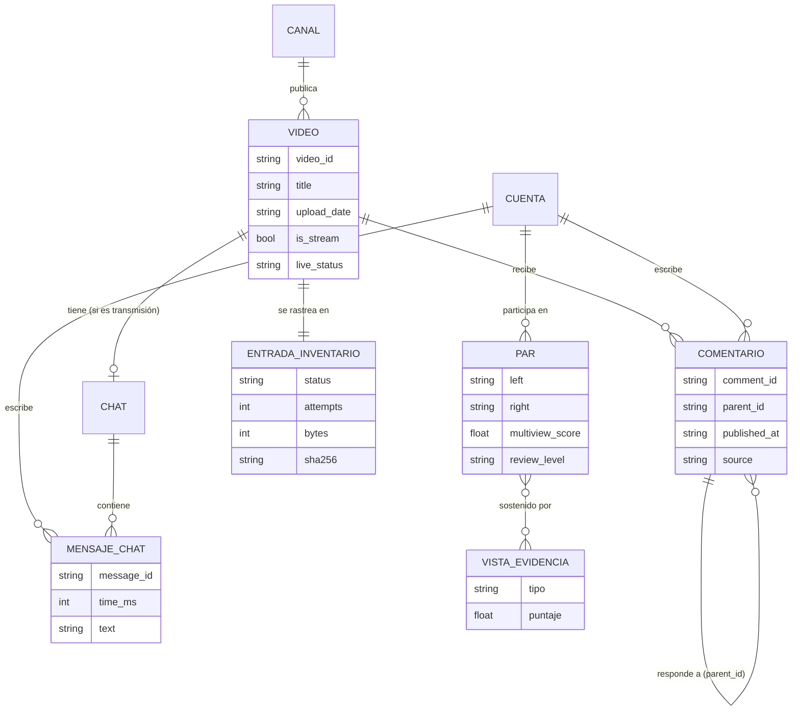

# Especificación

Especificación orientada a *spec-driven development* de `asambots`. Describe el comportamiento que el código
versionado implementa hoy; los criterios de aceptación remiten a pruebas existentes cuando las hay.

## 1. Propósito y alcance

**Propósito.** Reunir de forma reproducible los chats de transmisiones y los comentarios públicos de un canal de
YouTube y producir evidencia **auditable** que priorice cuentas y pares de cuentas para revisión humana por posible
automatización o coordinación.

**Dentro del alcance**

- Cosecha incremental de catálogo, chats de transmisiones finalizadas y comentarios con respuestas.
- Señales de comportamiento por cuenta y por par (texto, tiempo, plantillas, narrativas, recursos, respuestas).
- Clasificación por reglas (postura, temas, insultos, blancos, consignas) con mecanismos de corrección humana.
- Informes legibles y archivos de evidencia para auditar cada resultado.

**Fuera del alcance**

- Declarar que una cuenta es un bot o atribuir intención.
- Consultar perfiles de YouTube u otras fuentes externas para enriquecer cuentas.
- Modelos de aprendizaje automático, servicios en la nube, ejecución programada.

## 2. Requisitos funcionales

| ID | Requisito |
|---|---|
| RF-01 | El colector descubre los videos de un canal identificado por URL con handle (`/@nombre`) usando la YouTube Data API v3 o `yt-dlp`. |
| RF-02 | El colector restringe el catálogo a la ventana `[--since, --until]`, ambas fechas inclusivas, usando la fecha exacta del video cuando existe (`upload_date` precede a `published_at`). |
| RF-03 | Con backend `yt-dlp`, el colector hidrata cada candidato para obtener la fecha exacta antes del filtro final, salvo `--approximate-catalog-dates`. |
| RF-04 | El colector descarga la repetición del chat solo de transmisiones finalizadas; marca `not_applicable` los videos que no son transmisión y `deferred` las transmisiones activas o futuras. |
| RF-05 | El colector descarga comentarios superiores y todas sus respuestas, conservando `parent_id`. |
| RF-06 | El colector mantiene `inventory.json` con estado por video y por tipo de artefacto, intentos, ruta, registros, bytes y SHA-256, y no repite descargas completas válidas ni ausencias confirmadas. |
| RF-07 | El colector importa chats crudos preexistentes (`--legacy-chat-dir`) sin modificar la fuente y puede operar sin solicitudes remotas (`--legacy-only`). |
| RF-08 | Todos los analizadores leen chat canónico, comentario canónico y repetición cruda de YouTube a un modelo común (`Message`). |
| RF-09 | Cuando la entrada es un directorio con `catalog.jsonl`, `advanced_analysis`, `campaign_evidence`, `deep_coordination_analysis` y `text_content_analysis` excluyen registros de videos ausentes del catálogo y reportan cuántos excluyeron. |
| RF-10 | `bot_detector` calcula un `signal_score` 0–100 por cuenta con cinco componentes ponderados y un nivel de revisión. |
| RF-11 | `bot_detector` genera enlaces entre cuentas por mensajes exactos o casi iguales (Jaccard ≥ umbral) dentro de una ventana temporal, y clústeres por componentes conexos de enlaces con puntaje ≥ 35. |
| RF-12 | `advanced_analysis` prueba la sincronía temporal de cada par elegible contra un modelo nulo por sesión, corrige por pruebas múltiples (BH) y combina contenido, tiempo y plantillas en una red multivista. |
| RF-13 | `advanced_analysis` reporta la estabilidad de los pares al variar el tamaño del bin (`--sensitivity-bins`). |
| RF-14 | `campaign_evidence` etiqueta cada mensaje con una de cinco posturas, acepta correcciones humanas por CSV y evalúa redes multivista sobre el subconjunto estricto (apoyo directo) y el amplio (apoyo + ataques). |
| RF-15 | `deep_coordination_analysis` identifica candidatos por variantes léxicas, secuencias, recursos y respuestas, los prueba con permutación circular exacta y marca alta confianza solo si se cumple la regla de RF-16. |
| RF-16 | Regla de alta confianza: q ≤ 0,05, *lift* ≥ 1,5, solapamiento en ≥ 2 sesiones, al menos otra vista y recurrencia ≥ 3. |
| RF-17 | `text_content_analysis` asigna postura, temas, categorías de insulto, blancos atacados y consignas por mensaje, y agrega por cuenta, sesión, tema y blanco. |
| RF-18 | `deep_coordination_analysis` y `text_content_analysis` generan una muestra estratificada y determinista para validación humana. |
| RF-19 | Todos los CSV neutralizan celdas que podrían interpretarse como fórmula. |

## 3. Requisitos no funcionales

| ID | Requisito |
|---|---|
| RNF-01 Reproducibilidad | Los analizadores usan solo la biblioteca estándar; los muestreos y hashes son deterministas (`blake2b`, orden estable). Cada corrida escribe parámetros y versión en su resumen JSON. |
| RNF-02 Compatibilidad | Python ≥ 3.9. |
| RNF-03 Costo y cuotas | El colector trabaja por lotes (`--limit`, predeterminado 10 videos con trabajo por corrida), con pausas entre videos (`--sleep` 5 s) y entre clientes (`--client-sleep` 3 s). Con API, el consumo de cuota crece con el número de páginas de comentarios. |
| RNF-04 Robustez | Escrituras atómicas (temporal + `os.replace`); rotación de clientes de YouTube; el catálogo no se sobrescribe si `yt-dlp` no devuelve ninguna fecha (código 3). |
| RNF-05 Seguridad | La clave de API solo se lee de `YOUTUBE_API_KEY`; nunca se escribe en salidas. El raspado requiere `YOUTUBE_RASPADO=1`. CSV protegidos contra inyección de fórmulas; HTML con escape de todo el contenido. |
| RNF-06 Privacidad | Las salidas contienen identificadores y nombres públicos de cuentas y textos de mensajes; se generan en directorios locales excluidos de git. El puntaje base no usa postura política. |
| RNF-07 Transparencia metodológica | Los informes advierten que un puntaje alto no prueba automatización; `methodology.json` documenta método, parámetros, limitaciones y bibliografía. |
| RNF-08 Disponibilidad | No aplica: herramienta local sin servicio. |

## 4. Especificación por componente

### 4.1 `youtube_channel_collector.py`

**Entradas:** argumentos de CLI (sección 5.1), `YOUTUBE_API_KEY`, `YOUTUBE_RASPADO`, `YTDLP_BIN`, cookies opcionales,
directorio de chats heredados opcional.

**Salidas:** en `--output-dir`: `catalog.jsonl`, `inventory.json`, `chats/<fecha>__<slug>__<video_id>__chat.jsonl`,
`comments/<fecha>__<slug>__<video_id>__comments.jsonl`.

**Reglas**

- Selección de backend: `auto` → `api` si existe `YOUTUBE_API_KEY`, si no `ytdlp`.
- Se requiere `YOUTUBE_RASPADO=1` si: se refresca el catálogo con `ytdlp`, o se procesan chats (sin `--legacy-only`),
  o se procesan comentarios con `ytdlp` (sin `--legacy-only`).
- Estados de artefacto: `pending`, `downloading`, `complete`, `unavailable`, `not_applicable`, `deferred`, `error`,
  `missing`, `changed`.
- `should_process` devuelve falso si el artefacto está `complete` con archivo, tamaño y SHA-256 coincidentes, o si
  está `unavailable`/`not_applicable` sin `--retry-unavailable`.
- Nombre de archivo: `AAAA-MM-DD__<slug ≤ 80>__<video_id>__<tipo>.jsonl`; sin fecha, `fecha-desconocida`.

**Códigos de salida:** `0` éxito; `2` requisito faltante (permiso de raspado, `yt-dlp`, clave API, catálogo local con
`--no-refresh-catalog`) o argumentos inválidos; `3` catálogo `yt-dlp` sin ninguna fecha.

**Criterios de aceptación**

- CA-COL-01. **Dado** un video con `published_at` aproximado `2026-05-01` y `upload_date` exacto `20260423`, **cuando**
  se evalúa la ventana desde `2026-05-01`, **entonces** queda fuera. *(test_exact_upload_date_overrides_approximate_published_date)*
- CA-COL-02. **Dado** un artefacto completo inventariado, **cuando** su contenido cambia con el mismo tamaño, **entonces**
  pasa a `changed` y se vuelve a procesar. *(test_logica_pura: test_inventory_detects_modified_artifact_and_respects_unavailable)*
- CA-COL-03. **Dado** un entorno sin `YOUTUBE_RASPADO` ni clave, **cuando** se pide `--mode catalog`, **entonces** termina
  con código 2 sin escribir `catalog.jsonl`. *(test_scraping_requires_explicit_opt_in)*
- CA-COL-04. **Dado** un error *The page needs to be reloaded* en comentarios, **cuando** se descarga, **entonces** se rota
  al siguiente cliente. *(test_comments_rotate_client_after_reload_error)*
- CA-COL-05. **Dado** un chat heredado `__VIDEOID__chat.jsonl`, **cuando** se importa, **entonces** se produce JSONL
  canónico y la fuente queda intacta. *(test_legacy_chat_is_discovered_and_imported_without_changing_source)*
- CA-COL-06. `--legacy-only` sin `--legacy-chat-dir` y `--metadata-workers`/`--comment-workers` ≤ 0 son rechazados.

### 4.2 `bot_detector.py`

**Entradas:** archivo o directorio JSONL; `--sync-window` (s, 120), `--near-threshold` (0,5–1,0; 0,84).

**Salidas:** `summary.json`, `accounts.csv`, `coordination.csv`, `clusters.csv`, `report.html` (100 primeras cuentas y enlaces).

**Reglas**

- Un mensaje participa en enlaces exactos si su texto normalizado tiene ≥ 12 caracteres y ≥ 3 tokens; en casi
  iguales, si tiene ≥ 20 caracteres y 3–60 tokens informativos. Solo mensajes con `time_precision = exact`.
- Puntaje del par: 45 % eventos ponderados por rareza, 25 % sesiones, 20 % textos distintos, 10 % eventos.
- `signal_score` = 25 % repetición + 15 % entre sesiones + 20 % cadencia + 10 % volumen + 30 % coordinación; se
  multiplica por `n/10` si la cuenta tiene menos de 10 mensajes.
- Niveles: `< 5` mensajes → `evidencia_insuficiente`; ≥ 70 `muy_alta_revision`; ≥ 50 `alta_revision`; ≥ 25 `revision`;
  si no, `baja`.

**Códigos de salida:** `0`; `2` sin archivos, umbral fuera de rango o sin mensajes compatibles.

**Criterios de aceptación**

- CA-BD-01. **Dadas** dos cuentas que publican los mismos textos distintivos con segundos de diferencia en varias sesiones,
  **entonces** existe un enlace entre ellas. *(test_synchronized_templates_create_coordination_edge)*
- CA-BD-02. Una celda que empieza con `=` se escribe con `'` delante. *(test_csv_neutralizes_spreadsheet_formulas)*
- CA-BD-03. Los umbrales de nivel se aplican exactamente como arriba. *(test_risk_label_thresholds)*
- CA-BD-04. La CLI produce los cinco archivos y un `summary.json` con conteos correctos. *(test_cli_analyze_writes_all_outputs)*

### 4.3 `advanced_analysis.py`

**Entradas:** archivo o directorio; `--bin-seconds` 30, `--min-pair-messages` 10, `--fdr` 0,05, `--sync-window` 120,
`--near-threshold` 0,84, `--min-script-characters` 30, `--min-script-tokens` 6, `--component-threshold` 30,
`--sensitivity-bins` `20,30,45,60`.

**Salidas:** `account_fingerprints.csv`, `most_active_users.csv`, `temporal_coordination.csv`, `shared_scripts.csv`,
`multiview_edges.csv`, `network_components.csv`, `sensitivity.csv`, `sensitivity_edges.csv`, `pair_evidence.jsonl`,
`advanced_summary.json`, `methodology.json`, `advanced_report.md`.

**Reglas**

- Sincronía: por sesión, los bins se comprimen a los que tuvieron actividad; p-valor hipergeométrico de solapamiento
  por sesión, combinado con Fisher entre sesiones, q-valor BH sobre todos los pares probados.
- `temporal_score` = 40 % significancia + 30 % efecto (*lift*) + 20 % recurrencia + 10 % soporte.
- Vista temporal: q ≤ 0,05 y `temporal_score` ≥ 25. Vista de contenido (una sola familia): enlace de contenido con
  puntaje ≥ 10 y ≥ 2 eventos, o `script_score` ≥ 25.
- `multiview_score` = 0,4 contenido + 0,4 tiempo + 0,2 plantillas, +12 si hay dos vistas (tope 100).
- Niveles: `multivista_fuerte` (2 vistas, ≥ 2 sesiones con solapamiento, puntaje ≥ 45), `multivista_una_sesion`,
  `una_vista_fuerte` (alguna vista ≥ 45), `debil`.

**Criterios de aceptación**

- CA-ADV-01. Comentarios con precisión diaria no generan sincronía temporal. *(test_day_precision_comments_do_not_create_temporal_synchrony)*
- CA-ADV-02. Un par sincronizado supera a uno no sincronizado. *(test_synchronized_accounts_rank_above_unsynchronized)*
- CA-ADV-03. Multivista exige dos vistas materiales; `multivista_fuerte` exige recurrencia temporal en ≥ 2 sesiones.
  *(test_multiview_requires_two_material_views, test_strong_multiview_requires_recurrent_temporal_overlap)*
- CA-ADV-04. Los q-valores BH son monótonos respecto del orden de los p-valores. *(test_bh_is_monotone_in_p_order)*

### 4.4 `campaign_evidence.py`

**Entradas:** archivo o directorio; `--labels` (CSV `normalized_text,label`), `--bin-seconds` 30,
`--min-account-messages` 5, `--sensitivity-bins` `20,30,45,60`.

**Salidas:** `campaign_summary.json`, `stance_accounts.csv`, `support_templates.csv`, `strict_support_edges.csv`,
`broad_aligned_edges.csv`, `classified_evidence.jsonl`, `stance_review.csv`, `campaign_report.md`.

**Reglas (orden de precedencia en `classify_text`)**

1. Apoyo + marca de ambigüedad (sarcasmo/negación) → `ambiguous_support`.
2. Entidad de Gobierno + expresión de apoyo → `direct_support`.
3. Blanco político o institucional + ataque → `opposition_or_institution_attack`.
4. Entidad de Gobierno + expresión negativa cercana → `possible_criticism`.
5. En otro caso → `other`.

Una corrección humana (texto normalizado igual) reemplaza la etiqueta y registra la regla `revision_humana`. Las
etiquetas no válidas en el CSV se ignoran.

**Criterios de aceptación**

- CA-CE-01. Un ataque a la oposición no se cuenta automáticamente como apoyo. *(test_opposition_attack_is_not_automatically_support)*
- CA-CE-02. Apoyo sarcástico se etiqueta `ambiguous_support`. *(test_sarcastic_support_is_ambiguous)*
- CA-CE-03. Una corrección humana prevalece sobre la regla. *(test_override_replaces_rule_label)*

### 4.5 `deep_coordination_analysis.py`

**Entradas:** archivo o directorio; `--labels`, `--bin-seconds` 30, `--min-account-messages` 10,
`--max-candidate-pairs` 1500, `--validation-per-label` 100. (`--simulations` existe oculto y no se usa.)

**Salidas:** `narrative_clusters.csv`, `lexical_variants.csv`, `account_narrative_network.csv`,
`account_narrative_sessions.csv`, `shared_sequences.csv`, `shared_resources.csv`, `reply_network.csv`,
`temporal_permutation.csv`, `temporal_overlap_evidence.csv`, `political_controls.csv`, `coordination_candidates.csv`,
`high_confidence_groups.csv`, `human_validation_sample.csv`, `candidate_evidence.jsonl` (250 primeros),
`deep_summary.json`, `deep_report.md`.

**Reglas**

- Narrativas: reglas regex temáticas más la etiqueta de postura; la narrativa primaria sigue un orden de prioridad fijo.
- Variantes léxicas: textos ≥ 20 caracteres con ≥ 4 tokens canónicos; LSH por narrativa (6 bandas × 4 valores de
  MinHash); unión si Jaccard ≥ 0,68; un clúster requiere ≥ 2 cuentas.
- Secuencias: trigramas de narrativas consecutivas distintas por cuenta y sesión, compartidos por 2–80 cuentas.
- Recursos: URL, dominios, hashtags y secuencias de ≥ 4 emojis compartidos por 2–100 cuentas.
- Permutación: distribución exacta de todos los desplazamientos circulares por sesión, convolucionada entre sesiones; BH.
- Vistas: contenido (≥ 2 clústeres léxicos o secuencias en ≥ 2 sesiones), recurso (≥ 1 recurso en ≥ 2 sesiones),
  respuesta (≥ 3 respuestas en ≥ 2 videos), temporal (regla de RF-16).

**Criterios de aceptación**

- CA-DEEP-01. Un candidato con vista temporal y otra vista y recurrencia ≥ 3 es de alta confianza; con q > 0,05 no lo es.
  *(test_high_confidence_rule)*
- CA-DEEP-02. Las variantes nominales de las entidades de Gobierno se canonizan a un mismo concepto.
  *(test_canonical_tokens_merge_government_entities)*

### 4.6 `text_content_analysis.py`

**Entradas:** archivo o directorio; `--output` (`text_analysis`), `--validation-per-stratum` (> 0; 100).

**Salidas:** `message_classifications.csv`, `stance_stats.csv`, `theme_stats.csv`, `theme_stance_matrix.csv`,
`insult_stats.csv`, `target_stats.csv`, `slogans.csv`, `account_content_profiles.csv`, `session_content_stats.csv`,
`human_validation_sample.csv`, `content_summary.json`, `content_report.md`.

**Reglas**

- Postura: `pro_gobierno`, `contra_gobierno`, `mixto`, `ambiguo`, `sin_postura_clara`. Los títulos genéricos
  ("presidente") exigen cercanía léxica estricta; hipotéticos y condicionales no cuentan como postura del autor.
- Temas (16 categorías: Ejecutivo, energía, elecciones, Asamblea, oposición, Poder Judicial, corrupción, seguridad,
  economía, salud, educación, ambiente, infraestructura, prensa, religión, género y derechos humanos).
- Insultos (6 categorías); nivel `alta` si hay deshumanización, acusación de abuso sexual o profanidad agresiva.
- Blancos: personas públicas, colectivos, organizaciones, instituciones, sector prensa y handles `@`. Un insulto se
  atribuye al blanco más cercano (≤ 80 caracteres).
- Consigna: clave normalizada ≥ 12 caracteres y ≥ 3 palabras, no administrativa ni saludo genérico; requiere ≥ 3
  mensajes y (≥ 2 cuentas o una cuenta con ≥ 5).

**Criterios de aceptación**

- CA-TXT-01. Apoyo condicional o hipotético no es postura del autor. *(test_conditional_support_is_not_authors_stance, test_hypothetical_president_is_not_current_government)*
- CA-TXT-02. Un insulto se asigna al blanco más cercano. *(test_attack_is_assigned_to_nearest_target)*
- CA-TXT-03. Crítica de política pública no es automáticamente insulto. *(test_policy_criticism_is_not_automatically_an_insult)*

## 5. Contratos e interfaces

### 5.1 CLI

```text
youtube_channel_collector.py [--channel URL] [--output-dir DIR] [--since AAAA-MM-DD] [--until AAAA-MM-DD]
    [--mode {all,catalog,chats,comments}] [--catalog-backend {auto,api,ytdlp}]
    [--comments-backend {auto,api,ytdlp}] [--no-refresh-catalog] [--catalog-limit N]
    [--approximate-catalog-dates] [--limit N] [--max-comments {all|N}] [--sleep S] [--client-sleep S]
    [--metadata-workers N] [--comment-workers N] [--cookies ARCHIVO] [--cookies-from-browser NAVEGADOR]
    [--legacy-chat-dir DIR] [--legacy-only] [--retry-unavailable] [--dry-run]

bot_detector.py analyze ENTRADA [--output DIR] [--sync-window S] [--near-threshold J]
advanced_analysis.py ENTRADA [--output DIR] [--bin-seconds S] [--min-pair-messages N] [--fdr Q]
    [--sync-window S] [--near-threshold J] [--min-script-characters N] [--min-script-tokens N]
    [--component-threshold P] [--sensitivity-bins LISTA]
campaign_evidence.py ENTRADA [--output DIR] [--labels CSV] [--bin-seconds S]
    [--min-account-messages N] [--sensitivity-bins LISTA]
deep_coordination_analysis.py ENTRADA [--output DIR] [--labels CSV] [--bin-seconds S]
    [--min-account-messages N] [--max-candidate-pairs N] [--validation-per-label N]
text_content_analysis.py ENTRADA [--output DIR] [--validation-per-stratum N]
```

Directorios de salida predeterminados: `presidencia_data`, `results`, `advanced_results`, `campaign_analysis`,
`deep_analysis`, `text_analysis`.

### 5.2 Formatos JSONL (ejemplos sintéticos)

**Catálogo** (`catalog.jsonl`):

```json
{"video_id": "AAAAAAAAAAA", "title": "Conferencia", "published_at": "2026-05-02T18:00:00+00:00",
 "upload_date": "20260502", "channel_id": "UC...", "channel_title": "Canal", "url": "https://www.youtube.com/watch?v=AAAAAAAAAAA",
 "catalog_backend": "yt_dlp", "date_precision": "exact", "is_stream": true, "live_status": "was_live"}
```

Con backend API se agregan `duration`, `comment_count` y `privacy_status`.

**Chat canónico** (`chats/*.jsonl`):

```json
{"record_type": "chat_message", "video_id": "AAAAAAAAAAA", "message_id": "m1", "time_ms": 12345,
 "published_at": "2026-05-02T18:03:25+00:00", "author_id": "UC_autor", "author_name": "@autor",
 "text": "Hola", "message_type": "liveChatTextMessageRenderer", "amount": null, "source": "yt_dlp_live_chat"}
```

`source` puede ser `yt_dlp_live_chat` o `chat_downloader`.

**Comentario canónico** (`comments/*.jsonl`):

```json
{"record_type": "comment", "video_id": "AAAAAAAAAAA", "comment_id": "c2", "parent_id": "c1", "is_reply": true,
 "author_id": "UC_autor", "author_name": "@autor", "text": "Respuesta", "like_count": 0,
 "published_at": "2026-05-03T00:00:00+00:00", "updated_at": null, "source": "yt_dlp"}
```

`source` puede ser `youtube_data_api` (hora exacta) o `yt_dlp` (precisión diaria).

**Inventario** (`inventory.json`, extracto):

```json
{"version": "1.1.0", "channel": "https://www.youtube.com/@CANAL", "window": {"since": "2026-05-01", "until": "2026-05-31"},
 "videos": {"AAAAAAAAAAA": {"metadata": {"video_id": "AAAAAAAAAAA"}, "active_in_catalog": true,
   "chat": {"status": "complete", "attempts": 1, "backend": "yt_dlp:web,ios", "path": "chats/....jsonl",
            "records": 1520, "bytes": 482113, "sha256": "…", "completed_at": "…"},
   "comments": {"status": "unavailable", "attempts": 1, "last_error": "commentsDisabled"}}},
 "counts": {"complete": 1, "unavailable": 1}, "updated_at": "…"}
```

**Correcciones humanas** (`--labels`):

```csv
normalized_text,label
texto normalizado del mensaje,other
```

## 6. Modelo de datos



`PAR` y `VISTA_EVIDENCIA` son conceptos de las salidas (filas de `coordination.csv`, `multiview_edges.csv`,
`coordination_candidates.csv`); las vistas son contenido, tiempo, plantillas, recursos y respuestas.

## 7. Trazabilidad

| Requisito | Módulo / función | Pruebas |
|---|---|---|
| RF-01 | `discover_channel_api`, `discover_channel_ytdlp`, `handle_from_channel` | `test_ytdlp_catalog_requests_approximate_dates`, `test_handle_from_channel` |
| RF-02 | `entry_day`, `within_window` | `test_window_is_inclusive_and_rejects_missing_date`, `test_exact_upload_date_overrides_approximate_published_date`, `test_default_window_starts_may_first_2026` |
| RF-03 | `hydrate_catalog_dates_ytdlp` | `test_ytdlp_hydration_replaces_approximate_date` |
| RF-04 | `main`, `download_chat`, `canonical_chat_records` | `test_chat_renderer_becomes_canonical` |
| RF-05 | `normalize_comment`, `download_comments_*` | `test_comment_normalization_keeps_reply_parent`, `test_comments_rotate_client_after_reload_error` |
| RF-06 | `Inventory` | `test_inventory_adopts_and_skips_existing_file`, `test_inventory_detects_modified_artifact_and_respects_unavailable` |
| RF-07 | `discover_legacy_chats`, `import_legacy_chat` | `test_legacy_chat_is_discovered_and_imported_without_changing_source`, `test_legacy_only_requires_a_source_directory` |
| RF-08 | `iter_messages` | `test_youtube_jsonl_parser`, `test_canonical_chat_is_consumed_by_detector`, `test_canonical_comment_is_consumed_without_false_second_precision` |
| RF-09 | `filter_messages_to_catalog` | `test_catalog_filter_excludes_downloaded_out_of_window_video` |
| RF-10 | `analyze`, `risk_label`, `percentile_ranks` | `test_risk_label_thresholds`, `test_percentile_ranks`, `test_cli_analyze_writes_all_outputs` |
| RF-11 | `find_coordination`, `build_clusters` | `test_synchronized_templates_create_coordination_edge`, `test_build_clusters_uses_only_strong_edges` |
| RF-12 | `temporal_synchrony`, `hypergeom_survival`, `fisher_combined_p`, `benjamini_hochberg`, `multiview_edges` | `test_hypergeometric_known_case`, `test_fisher_combined_p`, `test_bh_is_monotone_in_p_order`, `test_multiview_requires_two_material_views` |
| RF-13 | `sensitivity_analysis` | `test_sensitivity_reuses_and_compares_bins` |
| RF-14 | `classify_text`, `load_overrides`, `classify_messages` | `test_campaign_evidence.*`, `test_overrides_are_normalized_and_validated`, `test_override_replaces_rule_label` |
| RF-15, RF-16 | `lexical_clusters`, `circular_permutation`, `integrate_temporal` | `test_high_confidence_rule`, `test_minhash_is_deterministic_and_seeded` (permutación sin prueba directa) |
| RF-17 | `classify_stance`, `classify_content`, `is_slogan_candidate` | `test_text_content_analysis.*`, `test_slogan_candidate_requires_length_and_words` |
| RF-18 | `validation_sample`, muestra en `text_content_analysis.run` | Sin prueba |
| RF-19 | `write_csv` | `test_csv_neutralizes_spreadsheet_formulas` |
